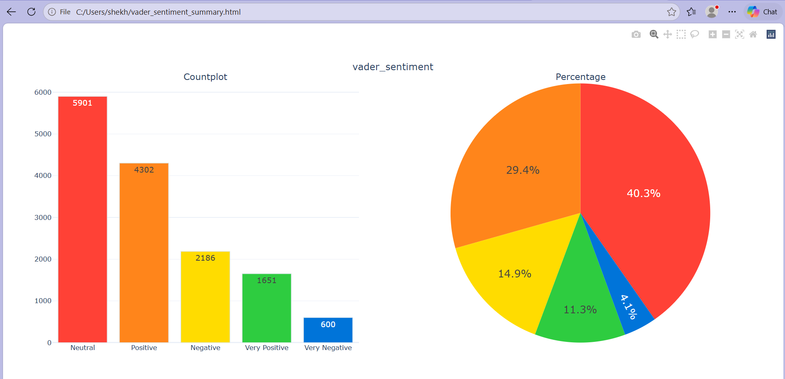
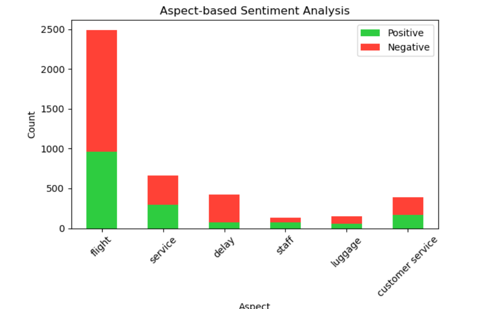
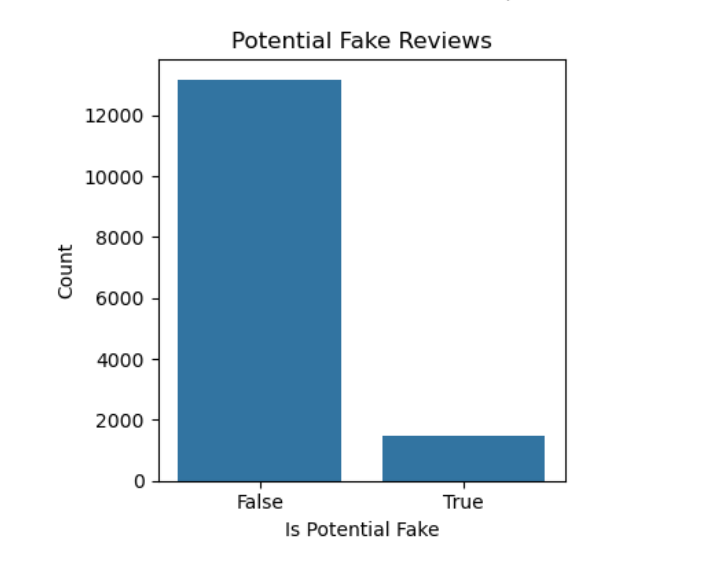

# Airline Tweets Sentiment Analysis

A Python NLP project that analyzes 14,640 airline customer tweets. It classifies
sentiment with VADER, finds opinions about specific aspects (flight, delay, staff, etc.),
flags potentially fake reviews, and lets you test your own text from the terminal.

## Results

### Sentiment Distribution (VADER)



| Sentiment | Count | Share |
|---|---|---|
| Neutral | 5,901 | 40.3% |
| Positive | 4,302 | 29.4% |
| Negative | 2,186 | 14.9% |
| Very Positive | 1,651 | 11.3% |
| Very Negative | 600 | 4.1% |

### Aspect-based Sentiment



| Aspect | Positive | Negative |
|---|---|---|
| flight | 958 | 1,531 |
| service | 293 | 365 |
| delay | 74 | 345 |
| staff | 72 | 61 |
| luggage | 52 | 101 |
| customer service | 168 | 219 |

### Potential Fake Reviews



## Key Insights

- **Neutral is the largest group (40.3%).** Positive and Very Positive together make up about 40.7%, against about 19.0% for Negative and Very Negative.
- **"Flight" is the most mentioned aspect** (2,489 mentions), and negative mentions outnumber positive ones (1,531 vs 958).
- **"Delay" is the most negative aspect.** 345 of 419 mentions (about 82%) are negative.
- **"Staff" is the only aspect where positive mentions outnumber negative ones** (72 vs 61).
- **1,475 reviews (10.1%) were flagged** as potentially fake by the rule-based checks.

## Features

- Sentiment classification into 5 levels: Very Positive, Positive, Neutral, Negative, Very Negative
- Aspect-based sentiment for: flight, service, delay, staff, luggage, customer service
- Rule-based potential fake review detection (very short text, overly positive wording, generic text)
- Interactive Plotly charts, plus Matplotlib/Seaborn charts
- Live review checker: type any review in the terminal and get its sentiment

## Tools and Libraries

- Python
- pandas, NumPy
- NLTK (VADER, stopwords, tokenizer)
- Matplotlib, Seaborn, Plotly

## Dataset

`Tweets.csv`: airline customer tweets (text column renamed to `reviewText`).
Source: [add dataset link, e.g. Kaggle "Twitter US Airline Sentiment"]

## How to Run

1. Install the libraries:
   ```bash
   pip install -r requirements.txt
   ```
2. Download the dataset and put `Tweets.csv` in the project folder.
3. Run:
   ```bash
   python sentiment_analysis.py
   ```
4. Close each chart window as it appears. After the charts, type a review in the terminal to test it, or type `exit` to quit.

## How It Works

1. Clean the text (remove symbols, lowercase)
2. Score each review with VADER and map the score to a sentiment label
3. Find aspect keywords and score the words around them
4. Flag possible fake reviews using simple rules
5. Plot the results

## Limitations

- Fake review detection is rule-based, not a trained model, so it can flag genuine reviews.
- VADER is lexicon-based and can miss sarcasm, which is common in complaint tweets.

## Author

Chirra Shekhar